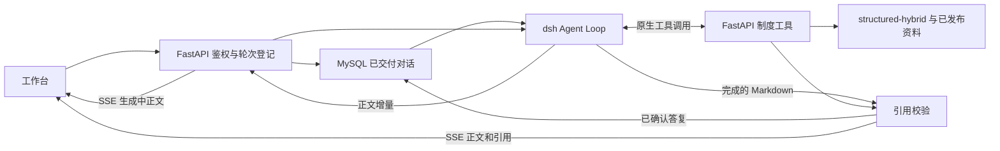

# FinOracle LLM 架构

## 问答执行

每个问答轮次由 DeepSeek Harness（`dsh`）运行一个 Agent。模型收到原问题、已授权的会话上下文和工具，可以直接作答、向用户澄清，或组合工具查证。证据不足时，模型说明缺口并给出有依据的解释。FastAPI 执行工具、核对引用与资料范围，并保存交付结果。

`dsh` 最多发起三次 Agent 模型调用，最后一次用现有证据收尾。FastAPI 校验工具参数、资料范围、调用预算与重复调用，每轮最多执行四个不同的有效工具请求。配置与部署见 [运行时连接](../backend/app/agent/dsh.py) 与 [dsh 说明](../backend/dsh/README.md)。

## 工具与证据

| 工具 | 行为 |
| --- | --- |
| `search_knowledge(query)` | 复用 `services.search.search()` 和 `structured-hybrid`，在可见的发布资料中混合检索。 |
| `get_article(document, article, start_ordinal?)` | 按制度 ID、标题或文号定位发布版本，查找规范化条号并返回按原文顺序排列的切片。 |
| `get_document_status(document, version_hint?)` | 查询发布版本的文号、时效、生效和核验日期；提供版本线索时核对版次。 |
| `reuse_answer_evidence(turn_id)` | 复核当前会话上下文中已交付答复的原有引用，验证可见性后签发本轮标记。 |

模型用普通 Markdown 表达最终答复，具体监管主张在出处附近附本轮工具发出的不透明标记。FastAPI 保留本轮实际送给模型的摘录和版本；引用只能使用本轮可用标记，最终交付前再次核对来源仍处于发布和授权范围。历史标记、猜测编号与下架资料均不可作为新引用。参见 [工具实现](../backend/app/agent/tools.py) 与 [证据校验](../backend/app/agent/delivery.py)。

一部制度最多有一个已发布版本。替换或下架会归档旧版本，原件和切片保留，向量随后清理。制度时效来自版本登记字段，`unknown` 表示待核验。参见 [发布服务](../backend/app/services/document_publishing.py)。

## 交付与流式界面

工作台通过 `POST /api/v1/chat/stream` 发问。正文随模型生成以 `answer_delta` 实时显示，工具和模型调用进度同时返回；内部证据标记在流中隐藏。模型完成后，FastAPI 校验格式、引用来源、条号、文号和版本等字段，再生成正式引用。参见 [流式桥接](../backend/dsh/bridge.mjs) 与 [引用组装](../backend/app/agent/citations.py)。

FastAPI 按 Markdown 块写入可交付正文并发出 `paragraph`，落库后发 `done`（含 `turn_id`、正文、引用和状态）。无引用的解释或澄清作为普通答复交付；校验丢失部分内容时为 `partial`，无可交付正文时为 `insufficient_evidence`。停止、断流或刷新时按业务轮次恢复已保存内容。参见 [SSE 接口](../backend/app/api/v1/endpoints/chat.py) 与 [API 说明](api.md#制度问答与会话)。

引用编号通过 `GET /api/v1/chat/references/{kind}/{id}`（`kind` 为 `chunk` 或 `version`）打开详情，读取时重新检查发布状态，下架后返回 404。

## 对话与运行会话

MySQL 的 `chat_sessions` 和 `chat_session_events` 存放业务会话、问题、已交付答复和轮次状态。每轮从当前会话提取最近至多 12 个已完成轮次的有界内容，优先保留最新答复；上下文文本中的指令按资料处理。参见 [上下文组织](../backend/app/agent/context.py) 与 [会话服务](../backend/app/services/chat_sessions.py)。

桥接按业务轮次创建 `dsh` 运行会话，无论运行时是否重启，页面刷新和后续轮次均从 MySQL 已交付结果恢复。
