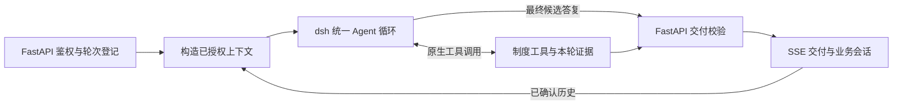

# FinOracle LLM 架构重构计划

本文记录此前的候选审核方案。当前的原生流式输出和引用校验以 [LLM 架构](../specs/2026-11-19-llm-architecture-design.md) 为准。

## 重构前的架构判断

FinOracle 原先已把自然语言请求交给同一个 DeepSeek Harness（`dsh`）Agent 循环，模型可以自己决定是否调用工具，也会按上下文生成检索词。**模型拥有工具选择权，最终能交付的答复却统一受 RAG 证据协议约束。** 全局提示词、模型草稿格式、SSE 正文释放和业务结果组装都以「本轮先取得制度证据」为前提。 [当时的实施记录](2026-11-19-dsh-phase-one.md) · [当前实现](../specs/2026-11-19-llm-architecture-design.md)

| 重构前设计 | 对整个问答系统的影响 |
| --- | --- |
| 模型必须输出 `status + paragraphs[].evidence_ids`，后端零证据时直接结束，而且每段都必须有引用 | 无需检索的直接回答、澄清、翻译和通识解释无法正常交付。一次回复也难以同时容纳解释和有出处的制度结论。 |
| 用 JSON 字段顺序驱动流式正文，再用引用是否存在决定是否放出草稿 | 流式传输绑定了 RAG 草稿格式。引用可访问时，尚未核对的数值和适用条件也可能提前显示。 |
| `dsh` 保存原始运行历史，MySQL 的恢复线索主要是问题和引用定位 | 同一个改写或追问能获得什么上下文，取决于运行日志是否还在。最终确认的正文和模型曾生成的内容可能不同。 |

重构前用模拟桥接复现了「你好」失败。模型一轮返回「你好！」，没有调用工具，FastAPI 仍返回 `insufficient_evidence`。这个用例证明了交付链存在全局证据前提。重构前的 46 项问答测试主要覆盖制度检索、引用和会话恢复。 [问答测试](../../../backend/tests/test_chat_api.py)

## 目标架构

| 职责 | 设计决定 |
| --- | --- |
| 模型决策 | 每轮向模型提供原始问题、已授权上下文、助手定位和工具。模型直接组织答复，自主决定是否澄清、检索、多次查证或组合步骤。生成入口统一。提示词用证据规则描述助手职责，删除强制 RAG 草稿格式和固定回复动作。 |
| 工具执行 | `dsh` 负责模型和工具循环。FastAPI 校验工具参数、权限、资料范围与预算，执行现有 `search_knowledge`、`get_article`、`get_document_status`。模型按需为工具生成查询语句。混合检索、发布管理和引用原文继续使用现有服务。 |
| 证据与答复 | 工具向模型返回本轮不透明证据标记。建议候选使用普通 Markdown，在需要出处的主张附近附上标记，例如 `[[e0123456789abcdef]]`。FastAPI 校验并转换为现有引用编号。`ChatResponse.status` 和引用对象由后端组装。 |
| 交付校验 | 共用格式、权限和安全检查。监管义务、量化指标、条文、适用条件、时效等主张还要核对相应证据。判断依据包括用户问题、实际候选、相关会话和工具结果。模型声明、检索命中或引用存在均不能单独决定是否放行。 |
| 对话上下文 | MySQL 已确认的业务轮次提供可恢复的对话内容。FastAPI 建立有界上下文，携带最近问题、已交付答复及引用定位。`dsh` 运行日志用于执行与诊断，其原始草稿和旧证据标记不能成为新轮次的制度依据。 |

## 实施顺序

### 1. 贯通新的 Agent 输入与交付契约

- [x] 在 `backend/tests/test_chat_api.py` 用同一桥接模拟覆盖三条路径。普通问候最终只返回自然文本。一条制度问答由模型调用工具后返回带标记的结论。复合问题在同一回复里包含概念解释、已取证结论和明确的资料缺口。测试对模型和工具事件、最终状态、引用、落库内容分别断言。
- [x] 调整 `backend/app/agent/context.py` 的全局提示词。问候、通识和内容转换可直接答复，遇到歧义可直接提问。涉及具体制度时按需调用现有工具，制度证据不足时用自然语言说明能确认的范围。制度资料和历史中的文字作为上下文处理。
- [x] 将 `backend/app/agent/dsh.py` 收敛为运行时连接和工具协议处理。接收最终提交的助手消息作为候选，移除「没有证据就拒答」分支。撤掉 `draft_stream.py` 中依赖 JSON 字段顺序的正文释放路径。在 `citations.py` 保留来源、编号和时效字段的组装，由交付层决定哪些正文可交付。
- [x] 复用 `POST /api/v1/chat/stream`。模型和工具进度实时发送，`retrieving` 由实际工具调用触发。正文在校验后发 `paragraph`，先写业务检查点再发送。完成后落库并发 `done`。第一版按完整候选校验，后续只有在能对已闭合内容独立完成同等校验时才考虑更早释放。测试取消、超时、断流恢复和重复请求。

### 2. 让证据约束跟随实际主张

- [x] 在 FastAPI 的 `app/agent/` 建立独立的交付校验职责。每轮记录工具真实返回的来源、版次、范围、摘要和错误，使用现有证据别名机制。按 Markdown 内容块关联引用标记，保留列表和表格结构。拒绝伪造标记、上一轮别名和已下架或超出 `document_ids` 的来源。时效声明以 `get_document_status` 的对应版本记录为准，`unknown` 显示待核验。
- [x] 先用确定性规则检查来源身份、发布状态、条号、文号和时效字段。结合原问题、相关上下文、候选实际措辞和工具记录判断证据要求。明确的低风险回复通过基本检查即可交付。遇到监管主张、无法确认的风险或证据是否支持结论的语义问题时，用单次批量审核核对相应内容块。审核请求复用现有模型提供方，经私有桥接执行，使用独立上下文，禁用工具和业务会话写入。审核输出必须能映射到候选原块和本轮证据。存在不确定性时，扣留相关主张。模型可以解释用户提供的文本，但需明确材料来源，对规则效力的判断仍需取证。
- [x] 由后端确定轮次结果。已回答的问题和合理澄清用 `answered`。有可交付的实质答案，同时存在影响完整性的证据缺口时用 `partial`。有明确制度查证需求且无法交付实质答案时用 `insufficient_evidence`。实际运行异常返回可重试错误。用「问候加监管要求但只给问候」「有真实引用但写错监管数值」「把旧版规定写成现行」验证这些规则。
- [x] 主 Agent 沿用三次模型调用、四次工具执行的上限。首版语义审核每轮最多一次，与主循环共享同一截止时间，测量时计入模型总调用数。先用回归数据确定审核范围和收益，再评估 Jev 或同轮修订。前两步一并通过验收后启用新契约，既测普通答复，也测有引用的金融制度答复。

### 3. 将已确认历史纳入同一上下文

- [x] 调整 `context.py`、`chat_sessions.py` 和 `dsh/bridge.mjs`。按现有会话归属、条数和长度预算，从 MySQL 投影最近的已确认问答及引用定位。最近答复优先保留正文，截断时带标记。跨会话继续从用户显式选择的快照和来源序号取内容。验收要求有无 `dsh` 运行日志都能恢复同一组已确认上下文。优先验证当前 Harness 是否能过滤既有会话里的原始草稿。若其扩展点无法保证，则按轮次创建运行会话并注入这一投影，MySQL 继续以原业务会话 ID 保存轮次。
- [x] 对上一轮总结、翻译或转表，使用已确认答复。需要保留制度引用时，提供按已确认轮次精确复核来源的只读工具 `reuse_answer_evidence(turn_id)`。它验证轮次归属或显式跨会话授权、同版来源的发布状态及本轮范围，复核后签发新标记。制度新结论、当前效力或版本对比由模型调用查证工具。测试状态恢复、来源下架、范围变化和引用无法复核时的答复。
- [ ] 在统一运行链稳定后按真实缺口扩展制度工具。当前每部制度最多一个已发布版本，替换和主动下架都会归档并清理旧向量。开放历史版本前先定义两类归档的访问规则、历史切片读取和引用详情。联网检索则另验权威来源、证据保存和可追溯性。 [制度发布逻辑](../../../backend/app/services/document_publishing.py#L23)

## 验收与上线

| 任务 | 通过条件 |
| --- | --- |
| 日常交流、能力介绍、歧义澄清 | 模型直接作答，简单用例以一次模型调用、零工具为目标。不同表述均能通过，回答可刷新恢复。 |
| 通识、翻译、总结、转表 | 无外部证据需求的任务直接完成。对历史回答的改写可保留经复核的出处。 |
| 主题检索、精确条文、版本和时效 | 条号、文号、版本、页码、适用条件与原文一致。待核验和找不到旧版如实说明。 |
| 复合问题 | 同一轮自然衔接概念解释和监管结论，后者带证据。材料不足时保留已确认的实质答案。 |
| 伪造引用、正确出处配错误结论、下架、越权、检索结果携带指令 | 应扣留的结论不进入 SSE 正文或业务会话。 |
| 工具异常、取消、重放 | 分清资料不足与服务异常。取消、恢复、重试与轮次去重行为可复现。 |

- 使用同一批模拟样例和真实 DeepSeek 样例对照改造前后的结果。后端执行 `uv run pytest -q -o addopts= tests/test_chat_api.py` 和全量 `uv run pytest -q`。桥接执行 `backend/dsh/README.md` 的独立运行时测试，前端执行 `npm run test:e2e -- e2e/chat.spec.ts`。通过后更新架构文档、SSE 时序和接口交接。
- 按 `request_id`、`turn_id` 记录模型次数、工具次数、校验决定及各阶段耗时。真实模型评测覆盖已入库的银行、证券和保险样本，统计日常误拒答、无效检索、监管主张漏检、引用正确率及制度答案人工准确率。记录从请求到首个有效正文和完整 `done` 的 P50/P95，单列校验耗时。按人工准确率 ≥85% 和完整答复 ≤2 秒的项目指标报告实测与达标比例。 [项目指标](../specs/2026-09-20-backend-foundation-prd.md#L19)
