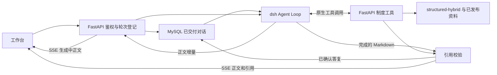

# FinOracle LLM 架构

## 问答执行

每个问答轮次由 DeepSeek Harness（`dsh`）运行一个 Agent。模型收到原问题、已授权的会话上下文和工具，可以直接作答、向用户澄清，或组合工具查证。证据不足时，模型可以说明缺口并给出有依据的解释。FastAPI 执行工具、核对引用与资料范围，并保存交付结果。

`dsh` 最多发起三次 Agent 模型调用，最后一次用现有证据收尾。FastAPI 校验工具参数、资料范围、调用预算与重复调用。每轮最多执行四个不同的有效工具请求。模型适配器、提供方和私有部署配置见运行时说明。 [运行时连接](../../../backend/app/agent/dsh.py) · [dsh 部署](../../../backend/dsh/README.md)

## 工具与证据

| 工具 | 行为 |
| --- | --- |
| `search_knowledge(query)` | 复用 `services.search.search()` 和 `structured-hybrid`，在可见的发布资料中混合检索。查询词由模型结合原问题与上下文生成。 |
| `get_article(document, article, start_ordinal?)` | 按制度 ID、标题或文号定位发布版本，查找规范化条号并返回按原文顺序排列的切片。多处同号时可按候选位置再查。 |
| `get_document_status(document, version_hint?)` | 查发布版本的文号、时效、生效和核验日期。提供版本线索时核对版次。未命中指定版本时，区分当前收录版本与用户询问的版本。 |
| `reuse_answer_evidence(turn_id)` | 复核当前会话上下文中已交付答复的原有引用。复核同版来源和资料范围后签发本轮标记。 |

模型用普通 Markdown 表达最终答复，具体监管主张在出处附近附本轮工具发出的不透明标记。FastAPI 保留本轮实际送给模型的摘录和版本。引用只能使用本轮可用的标记，最终交付前会再核对来源仍然处于发布和授权范围。历史标记、猜测的编号与下架资料均不可作为新引用。 [工具实现](../../../backend/app/agent/tools.py) · [证据校验](../../../backend/app/agent/delivery.py)

一部制度最多有一个已发布版本。替换或下架会归档旧版本，原件和切片保留，向量随后清理。用户端按发布范围访问资料。制度时效来自版本的登记字段，`unknown` 表示待核验。 [发布服务](../../../backend/app/services/document_publishing.py)

## 交付与流式界面

工作台通过 `POST /api/v1/chat/stream` 发问。正文随模型生成以 `answer_delta` 实时显示，工具和模型调用进度同时返回。浏览器只在当前调用展示临时正文，内部证据标记在流中隐藏。模型完成后，FastAPI 校验格式、引用来源、条号、文号和版本等可检查的字段，再生成正式引用；正文含义由主模型根据证据判断。 [流式桥接](../../../backend/dsh/bridge.mjs) · [引用组装](../../../backend/app/agent/citations.py)

FastAPI 按 Markdown 块写入可交付的正文并发出 `paragraph`，最终结果落库后发 `done`，包含 `turn_id`、正文、引用和状态。无引用的解释或澄清作为普通答复交付。引用校验丢失部分内容时使用 `partial`，无可交付正文时使用 `insufficient_evidence`。停止、断流或刷新时按业务轮次恢复已保存的内容。 [SSE 接口](../../../backend/app/api/v1/endpoints/chat.py) · [接口交接](../../backend-handoff.md#制度问答与会话)

引用编号通过 `GET /api/v1/chat/references/{kind}/{id}` 打开详情。`kind` 取 `chunk` 或 `version`。详情重新检查发布状态，返回制度、版本、条号、页码和原文等适用字段。下架后返回 404。

## 对话与运行会话

MySQL 的 `chat_sessions` 和 `chat_session_events` 存放业务会话、问题、已交付答复和轮次状态。每轮从当前会话提取最近至多 12 个已完成轮次的有界内容，优先保留最新答复。上下文文本中的指令按资料处理。 [上下文组织](../../../backend/app/agent/context.py) · [会话服务](../../../backend/app/services/chat_sessions.py)

桥接按业务轮次创建 `dsh` 运行会话。模型从当前授权上下文和本轮工具结果继续对话，旧模型草稿和旧工具结果留在原轮次运行日志中。已有业务会话继续使用原 ID。无论运行时是否重启，页面刷新和后续轮次都从 MySQL 的已交付结果恢复。

## 验收

自动化用例覆盖普通对话、澄清、制度问答、混合答复、无依据和伪造引用、来源下架、原引用复核、会话归属、停止和断流恢复。真实模型样例另行对照原文并测量首个有效正文和完整响应的延迟。准确率 ≥85% 和响应时间 ≤2 秒按完整项目样本实测。 [架构重构计划](../plans/2026-11-20-chat-response-policy.md) · [项目指标](2026-09-20-backend-foundation-prd.md#L19)
